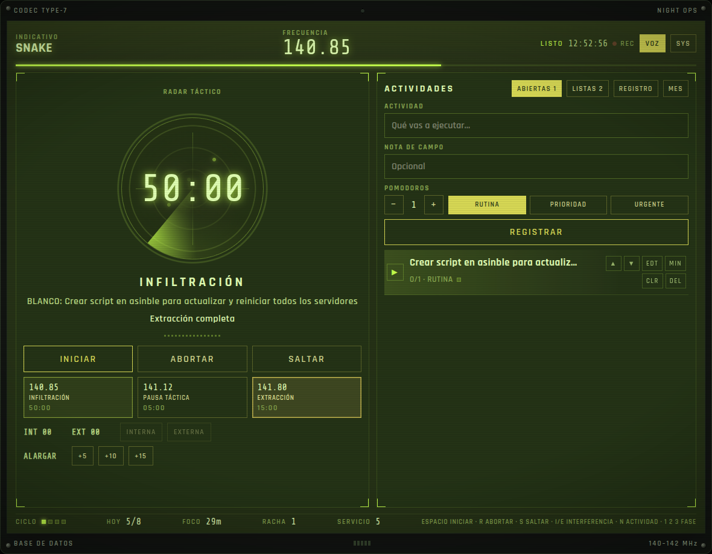
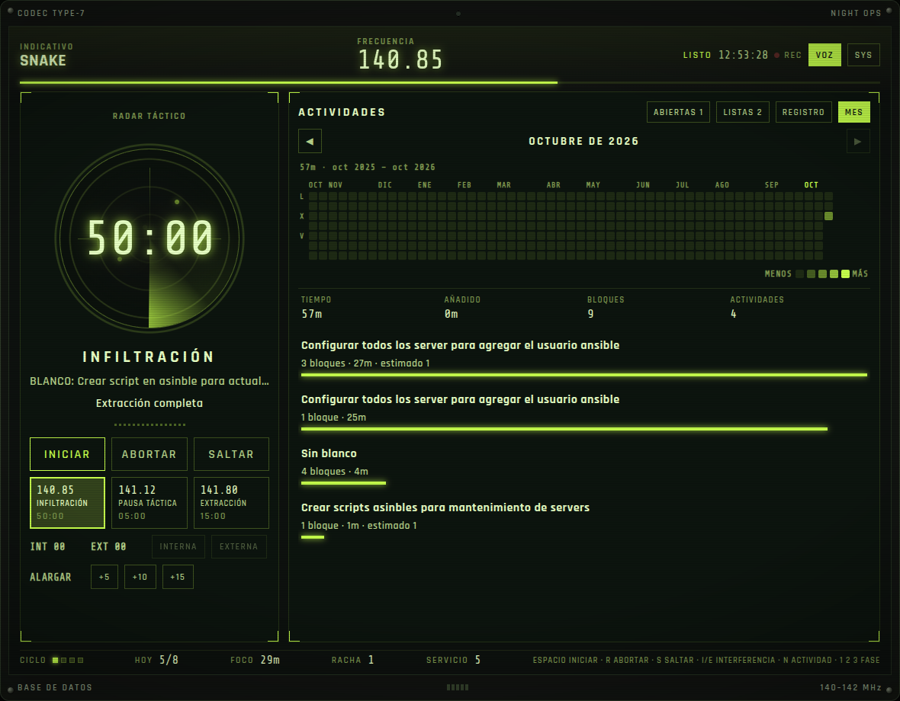
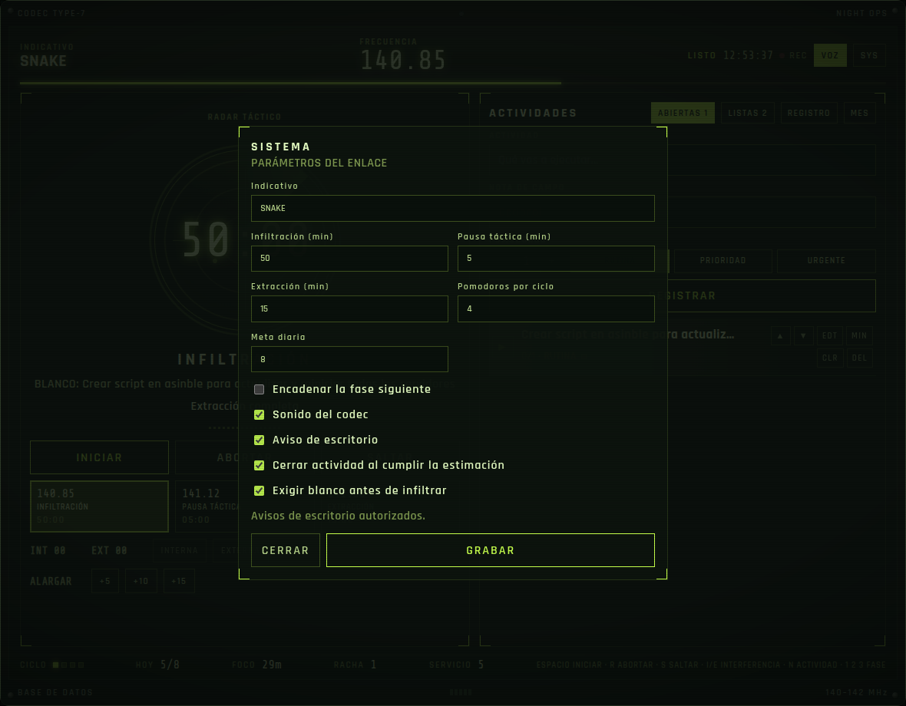

# CODEC // Pomodoro

A Pomodoro timer dressed as a Metal Gear codec. Register the work you are about to do, run the clock, and keep a monthly record of the time, including minutes you add by hand. The screen opens in English. **EN** and **ES** in the top bar switch the language, and the choice stays in this browser.



## Run it

Docker Compose starts the app and Postgres.

```bash
docker compose up -d --build
```

Open [http://127.0.0.1:8757](http://127.0.0.1:8757).

`docker compose down` stops the containers and keeps the database. `docker compose down -v` deletes the data.

Postgres is not published on the host. The app reaches it with `postgres://codec:codec@db:5432/pomodoro`.

## Phases

| Control | Frequency | Default | What it is |
| --- | --- | --- | --- |
| INFILTRATION | 140.85 | 25 min | Focus block |
| TACTICAL PAUSE | 141.12 | 5 min | Short break |
| EXTRACTION | 141.80 | 15 min | Long break, after a full cycle |

Press **START** to start the selected phase. **PAUSE** holds it, **ABORT** throws the block away, and **SKIP** moves on without recording it. A long break arrives after four completed infiltrations. Change that count in settings.

When you start a phase from its full duration, a short animation plays in the center and then leaves. It does not stay under the clock. Resuming a paused phase does not play it again. When an infiltration reaches zero, a salute marks **PHASE CLEAR** and the block is stored. Spanish uses the same controls under INFILTRACIÓN, PAUSA TÁCTICA, and EXTRACCIÓN.

## Activities

Type the work under **ACTIVITY**, set how many infiltrations you expect, choose **ROUTINE**, **PRIORITY**, or **URGENT**, and press **REGISTER**.

The active row is the target (**TARGET**) credited when the block finishes. **OPEN** lists open work. **DONE** lists finished work. **LOG** is the recent log. **CLR** marks a row done. **DEL** asks once, then deletes it.

**MIN** logs extra minutes on an activity immediately (+5, +10, +15, or +25), even if the clock is stopped. **EXTEND** adds 5, 10, or 15 minutes to the infiltration that is running. Those minutes count when the block closes. Aborting or skipping drops the extension.

## History

**MONTH** is a year of days, in the same shape as a contribution graph. The color is the time logged that day, including extra minutes. The list under the grid is the selected month. Click a day to see only that day. The arrows move between months.



## Keyboard

| Key | Action |
| --- | --- |
| Space | Start or pause |
| R | Abort |
| S | Skip |
| I / E | Mark an internal or external interruption during a running infiltration |
| N | Focus the activity field |
| 1 / 2 / 3 | Infiltration, tactical pause, extraction |

## Settings

**SYS** opens the link parameters: call sign, phase lengths, pomodoros per cycle, daily goal, chaining the next phase, codec sound, desktop notifications, closing an activity when its estimate is met, and requiring a target before an infiltration.



## Where the data lives

Postgres is the record. The timer, activities, and session history survive a restart. The month view reads the full history. The on-screen log only keeps the latest entries.
